[RU] Write-up: Статический семантический реверс-инжиниринг драйвера ОС MyPortIO_x64.sys (Gigabyte Control Center)
В данном write-up предоставлен очень детальный разбор о том, как я проводил статический , семантический реверс инжинирнг драйвера ОС MyPortIO_x64.sys, из утилиты Gigabyte Control center.
Цель - MyPortIO_x64.sys это драйвер маленьких размеров в пространстве ядра который позволяет получать доступ к портам ввода-вывода.
Реверс-инжиниринг Выше указанного драйвера был произведен полноценно на ассемблере без использование С кода, полностью «вслепую», то-есть без PDB-символов откладки и любых названий, а так же восстановление всего ключевых частей логики всех функций проводился принципиально без поиска структур и их смещений в интернете, полностью по контексту программы.
Каждая гипотеза по смещению/регистру/аргументу формулировалась самостоятельно ,А после моего окончательного заключении о том, что по моему мнению это за объект , гипотеза проверялась через интернет.
Так как данный анализ проводился в большей мере с целью научится восстанавливать структуры и логику кода без подручных средств, я решил восстанавливать абсолютно все функии просто для себя , как самочеллендж.
Так же фиксирование название функции было только после того, как гипотеза подтверждена логикой вызовов, а не с первой же догадки.

1) ProccessDriver + DriverEntry
В сегменте DriverEntry проводится инициализация , верно стандартные шаблонные функции такие как : «RtlInitUnicodeString», «IoCreateDevice», создание символической ссылки.
Гипотеза заключается в том что это точка входа драйвера для создания объекта устройства.
Подтверждено тем, что это опять же классический паттерн Windows-драйверов.
Так же хочу подметить ProccessDriver , которая пишет адрес MajorFunc сразу в несколько слотов таблицы DriverObject->MajorFunction( видно по смещениям.).
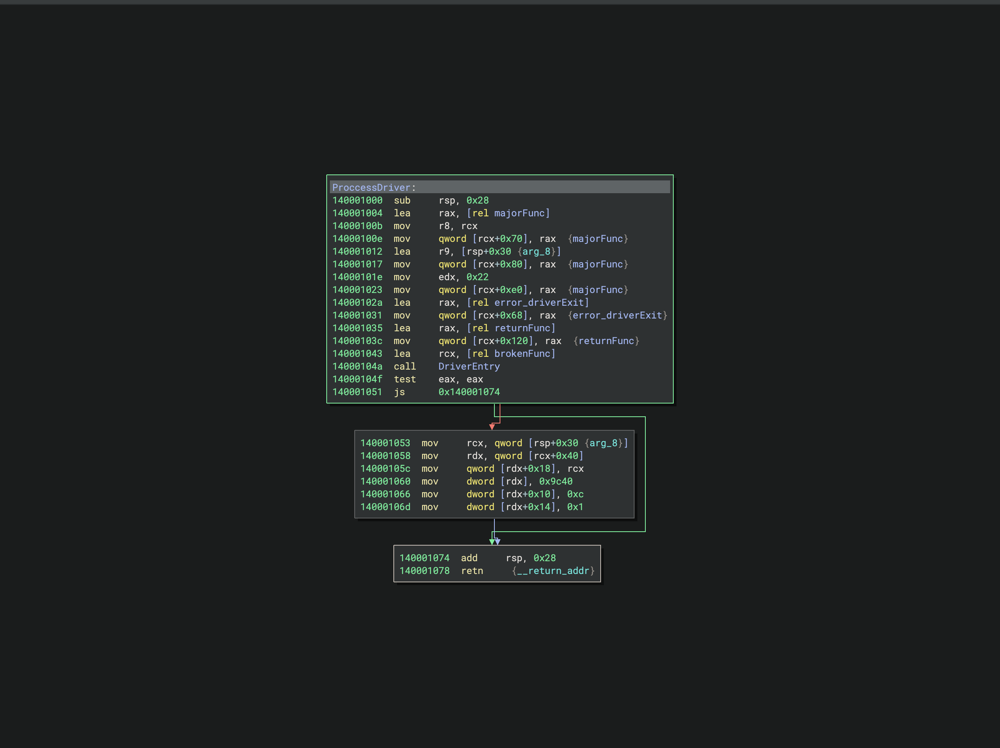 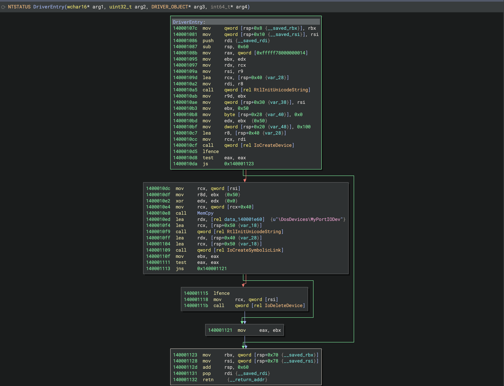

2) majorFunc
Можно назвать «главной» функцией от которой начинается все . Диспетчер IRP_MJ_DEVICE_CONTROL сигнатура majorFunc(void* arg, IRP* arg) восстанавливалась видимым признакам. Таким как : 1)arg1 выступает в роле указателя на объект устройства, arg2 это как раз таки IRP.
Гипотеза заключается в том , что инструкция mov r8, qword [rdx+0x8] представляет из себя непосредственно указатель на IO_STACK_LOCATION,а дальше mov r9d, dword  [rdx+0x18] чтение самого IoControlCode .
Далее заметно что драйвер не использует классический switch , а строит дерево сравнений по константам IOCTL-кодов, что является ярким признаком оптимизации от компилятора.
Хотел бы сделать акцент на том, как именно я понял что rdx+0x18 является IoStack , по нашим условиям, я не могу искать это в интернете, а восстанавливать это исключительно по контексту и логику.
Я пришел к этому решению опираясь на один основной факт который первый бросается в глаза,  в регистр r9d мы предварительно переместили ключевой объект, который далее сравнивается с регистром в котором находится самый настоящий IoCode, и сравниваем с eax в который предварительно положили объект, очень смахивающий на IoCode(0x9c406680), и сравниваем наши два ключевые объекта, что дает нам понять что rdx+0x18 это самый настоящий IO_STACK_LOCATION если учитывать особенности архитектуры Windows-драйверов, а если конкретнее так это то , что IoControlCode переходит в драйвер вместе с пакетом данных через IO_STACK_LOCATION. Похожих зацепок во всему MajorFunc достаточно много, не буду долго крутится вокруг них , учитывая что мы уже отследили ключевой объект который будет преследовать наш в дальнейшем по всему драйвер.
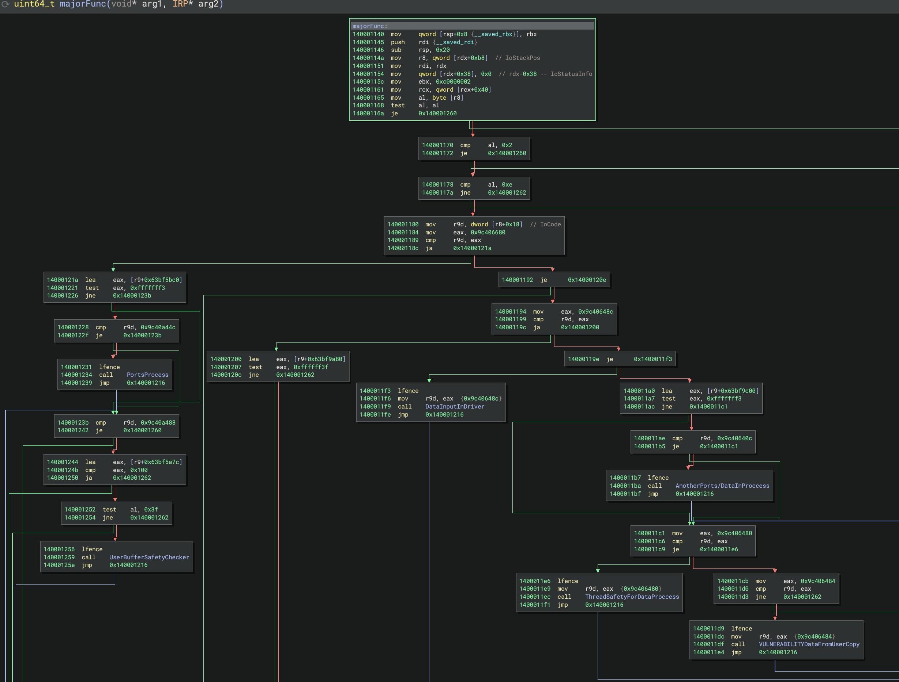

3) error_driver_exit
Удаление контекста драйвер , то-есть - выход.
Здесь я применял семантический реверс по конкретно скелету « не построчный разбор, а чтение системных функций , MmUnmapIoSpace, IoDeleteDevice, IoReportResourceUsage.
Если соединить их в кучу, То станет понятно что это устойчивый паттерн «аварийного» завершения инициализации драйвера.
И мы пришли к выводу что этого было достаточно, чтобы с уверенностью назвать функцию error_driver_exit  , не вникая в детали.
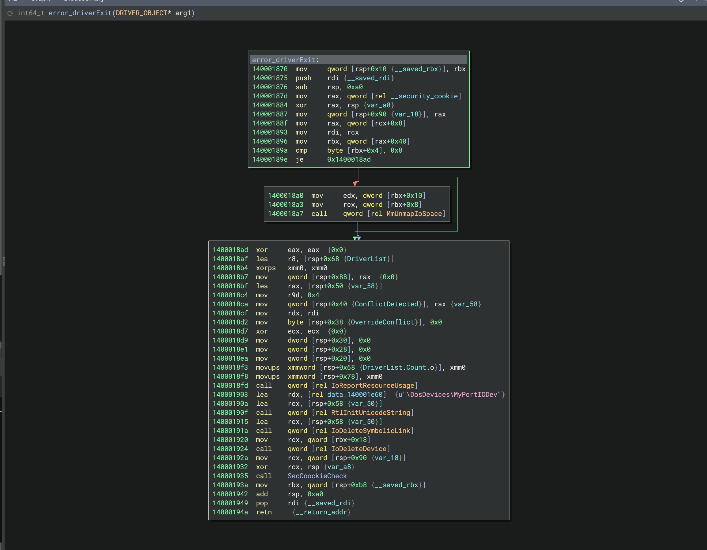

4) PortsProcess
Главный и самый объемный компонент всей нашей программы, обработчик портов.
Это был самый крупный и самый долго разбираемый «узел».
Восстановление шло поэтапно, через уточнение своих гипотез : С начала r8 я принял за чтото вроде массив каких то адресов/объектов, но отброшена сразу после того , как стало ясно, что это диапазоны портов, а не обычные значения.
Дальше идет проверка cmp rcx, 0xcf8 , данный порт является стандартным адресом шины PCI , и это дало понять что драйвер работает напрямую с системными портами.
Так же по инструкциям lea rcx, [rdx+0x4] + cmp rax, rcx было понятно, что это - классический паттерн границ диапазона который будет встречаться еще не раз .
Мы уже знаем что rdx+0x18 это у нас IoStack , а значит гипотеза про r8 как диапазоны разрешенных портов оказалось верной.
Итог: PortsProcess реализует доступ к запросам к конкретному портам с вариацией диапазона перед использованием.
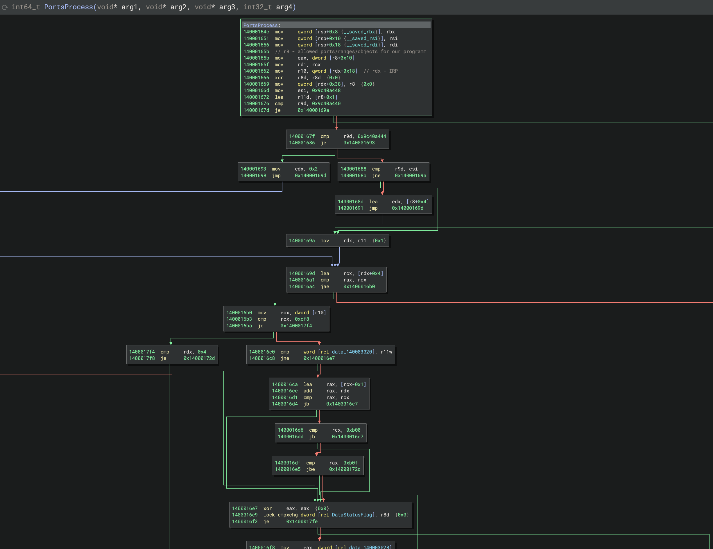

5) IOPortDispatcher
Можно сказать ядро работы с портами.
В этой части кода реальные in/out инструкции , которые для безопасности защищены атомарным примитивом lock cmpxchg для глобального флага состояния.
Гипотеза: сначала я ошибочно принял за безопасную проверку данных, однако уже встречая в коде проверку данных я усомнился в том что это тоже самое, потом прозрел, это же классический спинлок/мьютекс для критически важной секции в многоядерной среде, а не простая валидация данных.
Вывод: это движок порта, к которому обращаются части кода которые тоже должны иметь доступ к портам. Через них формируется маршрут данных от IRP пакета до самого железа .
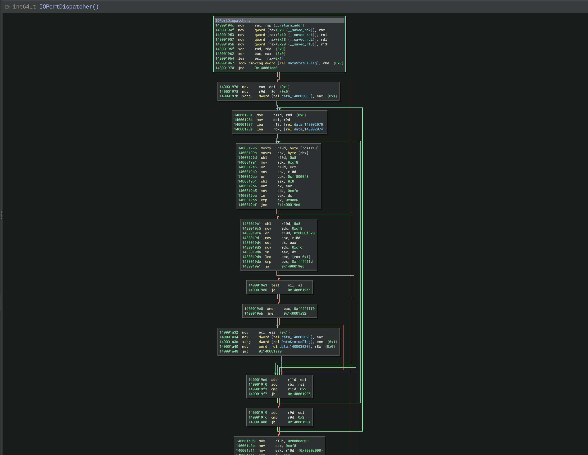

6) ThreadSafetyForDataProccess + DataInputInDriver
В это части кода нас встречает потокобезопасный прием данных.
Обе функции повторяют одни и те же действия , а именно : атомарная проверка занятости флага -> если ресурс свободен, вызов IoPortDispatcher -> чтение порта -> запись IoStatus флага в наш всеми известный IRP.
Итог: ThreadSafetyForDataProccess - как бы защитный «шлюз» который позволяет дать доступ к IoPortDispatcher ; DataInputInDriver - это уже приемник данных прямиком из портов.
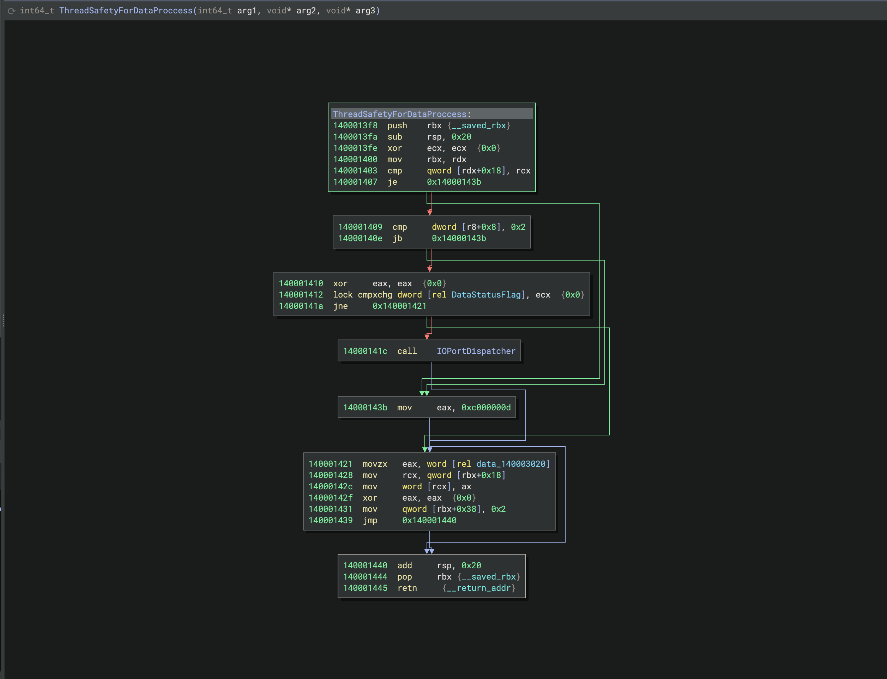 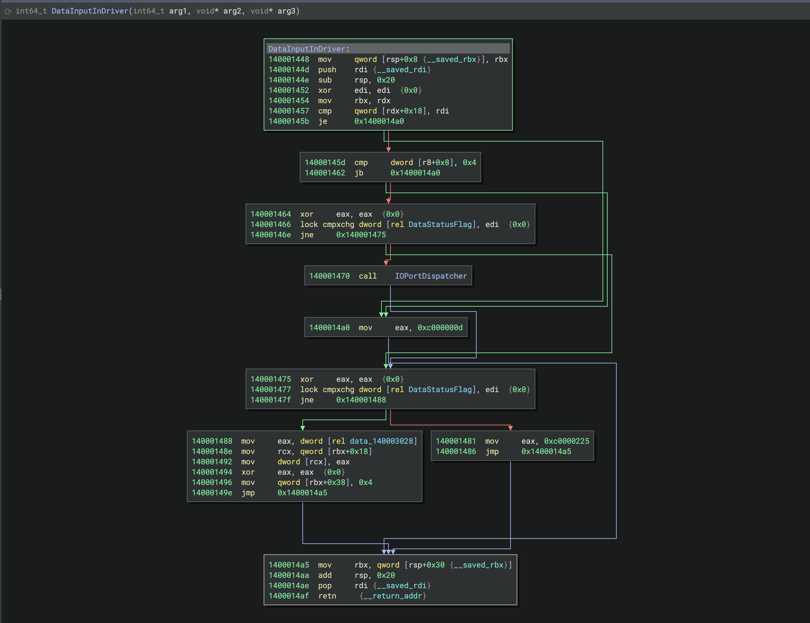

7) SafeGetDeviceStackEntry
Безопасный доступ к стеку.
Здесь восстанавливалась логика следующим образом: rcx - сюда по всему что-то в роде смещения/индекса , для стандартной проверки выхода за граница массива, и только затем передача аргументов и передача в следующий обработчик.
Сразу было видно что паттерн Validate->Lookup->Dispatch как стандартная архитектурная модель всего драйвер, что встречается и дальше в драйвере.
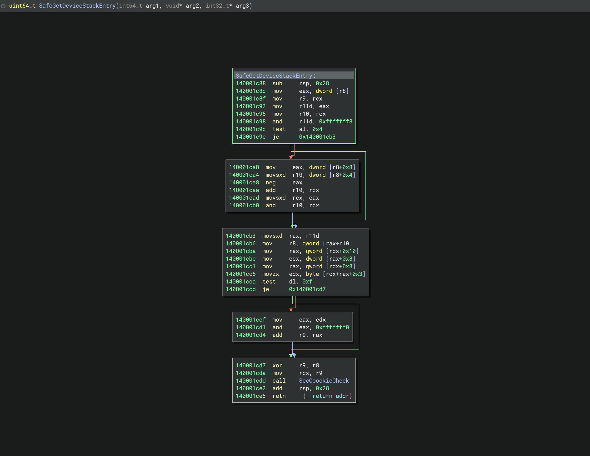

8) SecCookieCheck
Стандартная проверка __security_cookie , внутри SafeGetDeviceStackEntry был вызов это функции инструкциям rol|ror прямо над злачением, сверяемым с куками из .data/ Это классическая компиляторная защита от переполнения стека.

9) SystemCrash
int 0x29 (Fast Fail).
Ветка отказа из SecCookieCheck приводит нас прямо сюда, в ecx записывается стандартный код ошибки , а затем int 0x29, которое является программным пребыванием , вызывающее аварийное завершение .

10) SizeChecker + UserBufferSafetyChecker
Проверка входного буфера.
Это один из немногих показательных мест разбора - с начала несколькими самостоятельно откинутыми гипотезами : С начала r8+0x8 я принял за чтото вроде статус-флага .
Затем - за смещение/индекс.
Финально, проследив, что конкретно это значение в неизменном виде передается третьем аргументом в MemCpy , гипотеза подтвердилась с совсем иным исходом : r8+0x8 - это самый настоящий размер полезный загрузки, а r8+0x10 - это уже фиксированый размер .
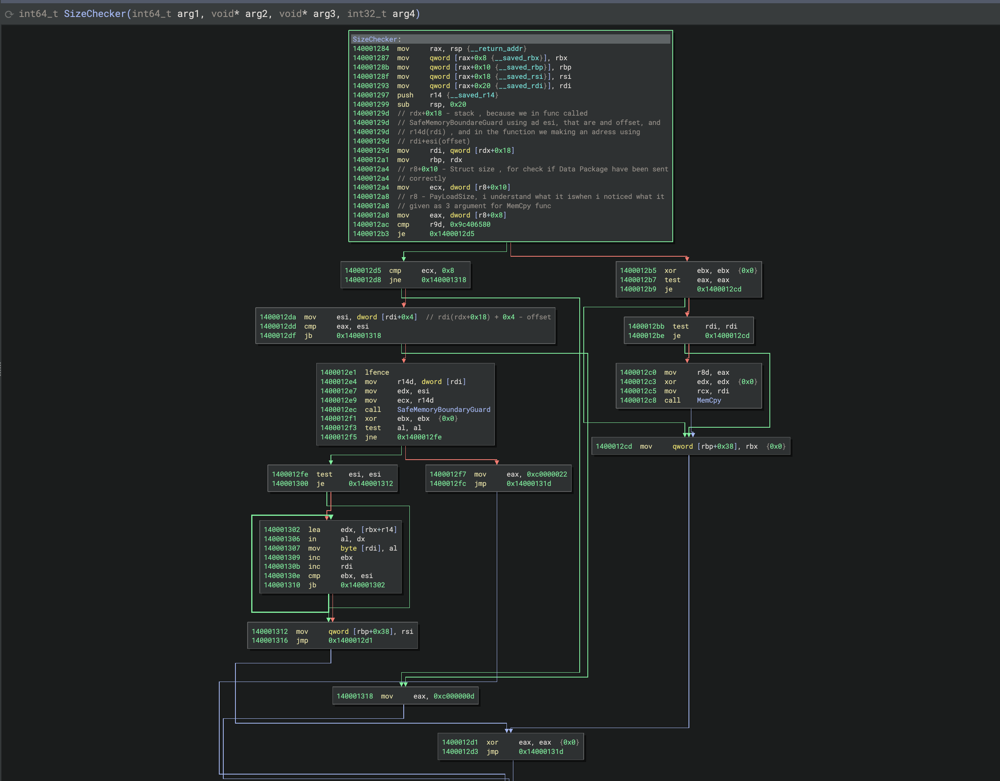 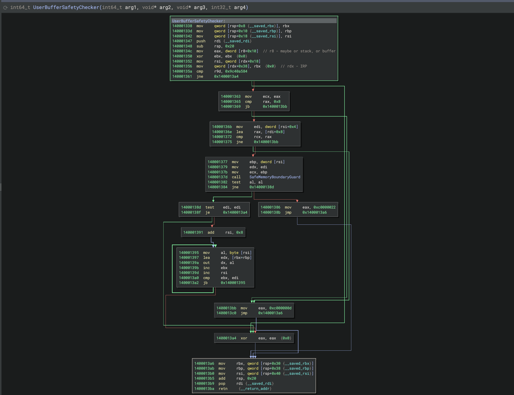

11) UserBufferSafetyChecker
Стандартная защита от переполнения в процессе вычисления смещений.
Ее уже я как раз таки разбирал вообще даже без возможности даже войти в интернет.
Процесс восстановления: с начала программа загружала как бы верхний лимит из глобальной переменной, через инструкцию  lea rax , [rcx+0xf] с последующим сравнением, можно сделать вывод что это стандартная проверка на целочисленное переполнение при выравнивании, и финальные сравнение индекса/размера с лимитом.

12) NegativeSizeCheck
Проверка знака.
Малого размера, но критичная функция test ecx, ecx + jns - отсекает отрицательные значения до того, как они попадут в главные вычисления , как вычисления смещений и подобные.
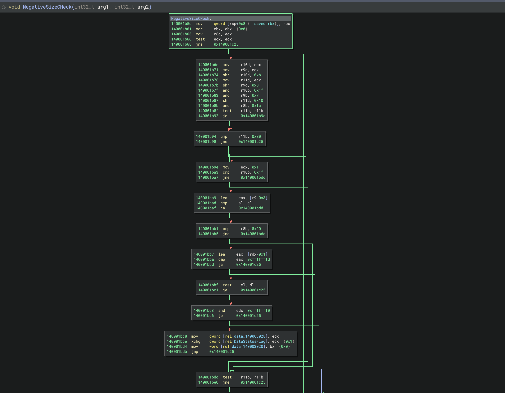 

13) DataFromUserCopy + MemCpy
Точка передачи данных в ключевые части программы.
Финальная цель маршрута: читает размер и указатель из IRP,а если точнее пользовательского буфера и вызывает кастомный MemCpy (SSE - оптимизированная рутина компилятора , movaps, выравнивание по 0x7, восстановление по стандартному шаблону генерированного компилятором MemCpy).
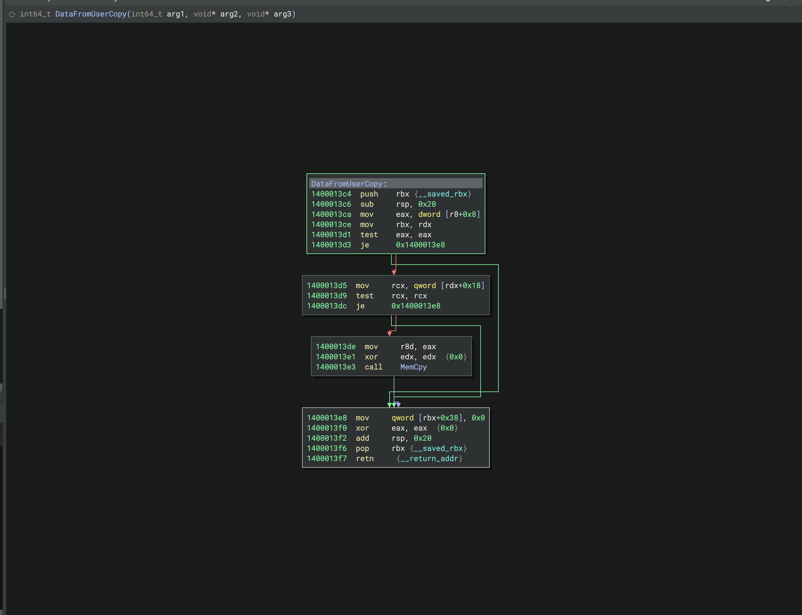

DriverEntry → ProccessDriver (MajorFunction table)
         → majorFunc (IOCTL dispatch tree)
             ├─ SizeChecker / UserBufferSafetyChecker (Buffer validation)
             │    └─ SafeMemoryBoundaryGuard / NegativeSizeCheck (Bounds/Sign check)
             │         └─ DataFromUserCopy → MemCpy
             ├─ PortsProcess ──┐
             ├─ ThreadSafetyForDataProccess ──┤
             ├─ DataInputInDriver ──┤→ IOPortDispatcher (in/out, lock cmpxchg)
             ├─ AnotherPorts/DataInProccess ──┘
             └─ (SafeGetDeviceStackEntry → SecCookieCheck → SystemCrash)
error_driverExit
(видно к сожалению только в режиме Code этого readme)

[EN] Write-up: Static Semantic Reverse Engineering of MyPortIO_x64.sys (Gigabyte Control Center)
This write-up provides a detailed walkthrough of a static, semantic reverse engineering analysis of the kernel-mode driver MyPortIO_x64.sys from the Gigabyte Control Center utility.
Target: MyPortIO_x64.sys is a lightweight kernel-mode driver designed to provide direct user-space access to hardware I/O ports.
The reverse engineering process was conducted strictly at the x64 assembly level without decompiling to C code. The analysis was performed completely "blind"—without PDB symbols, debugging names, or looking up OS structures and field offsets on the internet. All structure fields, offsets, and function logic were reconstructed entirely from binary execution context and register behavior.
Each hypothesis regarding offsets, registers, and function arguments was formulated independently first, and verified against external documentation only after a definitive conclusion was reached internally. This self-imposed challenge aimed to master manual structure reconstruction and binary analysis without external tools. Function names were assigned only when hypotheses were proven by control-flow logic rather than initial assumptions.

1) ProccessDriver + DriverEntry
In DriverEntry, standard initialization patterns are executed, including RtlInitUnicodeString, IoCreateDevice, and symbolic link creation.
Hypothesis: This function serves as the primary driver entry point responsible for device object instantiation.
Verification: Confirmed by standard Windows Driver Model (WDM) architecture patterns.
ProccessDriver populates the dispatch table by assigning the address of majorFunc to multiple slots within DriverObject->MajorFunction.
 

2) majorFunc
The primary entry dispatcher. Reconstructed as the IRP_MJ_DEVICE_CONTROL dispatch handler with the signature majorFunc(void* DeviceObject, IRP* Irp). Reconstructed based on key indicators: arg1 (RCX) acts as a pointer to DEVICE_OBJECT, and arg2 (RDX) represents the IRP pointer.
Hypothesis: The instruction mov r8, qword [rdx+0x8] extracts IO_STACK_LOCATION, followed by mov r9d, dword [rdx+0x18] to retrieve the target IoControlCode.
Instead of a standard switch block, the driver constructs a binary comparison tree over hardcoded IOCTL constants—a classic compiler optimization pattern for non-contiguous control codes.
Offset Reconstruction: rdx+0x18 was identified as IoStack strictly through context analysis. The register r9d holds the value retrieved from [rdx+0x18], which is directly compared against known IOCTL constant signatures (e.g., 0x9c406680 in EAX). In Windows driver architecture, the IoControlCode is passed within the IO_STACK_LOCATION structure embedded in the IRP.

3) error_driver_exit
Driver context cleanup and unwinding.
Reconstructed via semantic analysis of kernel API calls: MmUnmapIoSpace, IoDeleteDevice, and IoReportResourceUsage.
Conclusion: The combination of these specific tear-down routines forms an immutable pattern for emergency driver initialization failure unwinding (error_driver_exit).

4) PortsProcess
The central and most extensive component of the binary—the primary I/O port handling dispatcher.
Reconstructed iteratively through hypothesis refinement: r8 was initially hypothesized as an array of data structures, but was later re-evaluated as port range boundaries upon tracking hardware validation routines.
The instruction cmp rcx, 0xcf8 checks against the standard PCI bus configuration address port (0xCF8), confirming direct hardware/bus access capabilities.
Pattern matching using lea rcx, [rdx+0x4] paired with cmp rax, rcx identified a standard bounds-checking idiom. Combined with the established IoStack offset (rdx+0x18), r8 was verified as an array containing permitted hardware I/O port ranges.

5) IOPortDispatcher
The core execution engine for low-level port operations.
Contains direct in/out assembly instructions, synchronized using an atomic lock cmpxchg primitive acting on a global status flag.
Hypothesis: Initially assumed to be data sanitization. However, comparison with subsequent data validation logic revealed its true identity: an atomic spinlock/mutex securing critical section access in multi-core kernel environments.
Conclusion: Serves as the raw I/O execution engine accessed by higher-level wrapper routines, forming the execution path from the incoming IRP to physical hardware registers.

6) ThreadSafetyForDataProccess + DataInputInDriver
Thread-safe data ingestion interfaces.
Both routines execute a uniform sequence: Atomic flag availability check -> Resource lock acquisition -> Invocation of IOPortDispatcher -> Port read -> Writing IoStatus status fields back into the IRP structure.
Summary: ThreadSafetyForDataProccess acts as a thread-safe gatekeeper to IOPortDispatcher, while DataInputInDriver processes raw input streams received directly from physical hardware ports.
 

7) SafeGetDeviceStackEntry
Safe access interface for device stack locations.
Reconstructed by tracking rcx as an array index evaluated against upper boundary limits to prevent out-of-bounds indexing before argument setup and sub-handler invocation.
Exhibits the architectural Validate -> Lookup -> Dispatch pattern consistent across the driver binary.

8) SecCookieCheck
Standard compiler-generated stack canary validation (__security_cookie).
Invoked within SafeGetDeviceStackEntry, performing rol/ror bitwise rotations directly over values validated against global cookie values stored in .data to prevent stack buffer overflow exploitation.

9) SystemCrash
Fast-fail panic routine utilizing int 0x29.
The failure branch from SecCookieCheck routes directly here. Loads a failure code into ecx and executes software interrupt int 0x29 to initiate an immediate kernel bug check (BSOD), preventing further exploitation upon memory corruption detection.

10) SizeChecker + UserBufferSafetyChecker
User-supplied input buffer validation logic.
Reconstructed through hypothesis elimination: r8+0x8 was initially evaluated as a status flag, then as a structure offset. Tracking its raw value as argument 3 passed into MemCpy confirmed that r8+0x8 represents the actual payload size, while r8+0x10 defines the fixed header size.
 

11) UserBufferSafetyChecker
Integer overflow protection during buffer offset alignment calculations.
Analyzed completely offline without external reference access. Loads maximum size boundaries from global variables and executes lea rax, [rcx+0xf] followed by comparison instructions—a classic pattern for preventing integer overflow during memory alignment operations.

12) NegativeSizeCheck
Sign validation guard.
A compact routine consisting of test ecx, ecx followed by jns. Filters out signed/negative values before they reach arithmetic offset calculations, mitigating integer underflow vulnerabilities.
 

14) DataFromUserCopy + MemCpy
Final user-space data ingestion point.
Extracts buffer pointers and length fields from the user IRP payload, invoking an optimized MemCpy routine. Utilizes SIMD SSE optimizations (movaps, alignment masks 0x7), matching compiler-generated memory copy templates.

Overall Driver Architecture:

DriverEntry → ProccessDriver (MajorFunction table)
         → majorFunc (IOCTL dispatch tree)
             ├─ SizeChecker / UserBufferSafetyChecker (Buffer validation)
             │    └─ SafeMemoryBoundaryGuard / NegativeSizeCheck (Bounds/Sign check)
             │         └─ DataFromUserCopy → MemCpy
             ├─ PortsProcess ──┐
             ├─ ThreadSafetyForDataProccess ──┤
             ├─ DataInputInDriver ──┤→ IOPortDispatcher (in/out, lock cmpxchg)
             ├─ AnotherPorts/DataInProccess ──┘
             └─ (SafeGetDeviceStackEntry → SecCookieCheck → SystemCrash)
error_driverExit

(Unfortunately, this is only visible when viewing the 'Code' mode for this README.)
